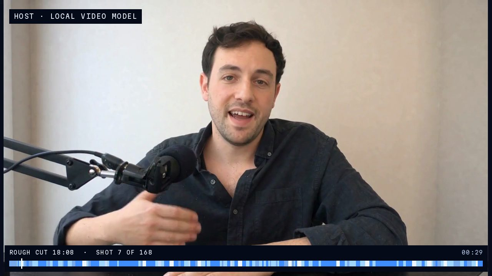
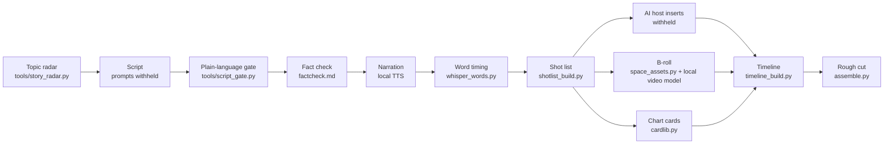

# ai-documentary-pipeline

**One overnight run on one GPU turned a science story into an 18-minute documentary rough cut:
script, narration, an AI host, 154 b-roll shots, and charts, with no human step in between.**

[](https://mhfx.ai/systems/ai-documentary-pipeline/)

- **Story to script.** A topic radar ranks story ideas from public science feeds. A plain-language
  gate checks the script for jargon, missing baselines, and a slow first 30 seconds.
- **Script to pictures.** Every narrated line becomes a shot: NASA/ESA archive video, photos
  animated by a local video model, generated clips, or a data chart in one house style.
- **Pictures to cut.** Word-level timing from speech recognition places every cut. Then the
  assembler builds the timeline and renders the rough cut.

This is a curated public snapshot of a private working repo. The code and data from the first
episode are here as they ran. A few parts are **withheld**: the AI host method, the narration voice, the
tuned script prompts, and adapters for paid services. Each withheld part has a short note where it
would sit. See [What is withheld](#what-is-withheld).

## Pipeline



All GPU work goes through one overnight queue (`episodes/ep001_sun/queue_run.py`). It runs one
job at a time under a GPU lock, waits while another process holds the card, logs every job to
`logs/gpu_log.csv`, and starts no new job after 07:30.

## Episode 001 (the Sun), run 1

Numbers come from [`episodes/ep001_sun/run1_report.md`](episodes/ep001_sun/run1_report.md).

| | |
|---|---|
| Runtime | 18.1 min (narration 937 s, host 116 s) |
| Cuts | 154 b-roll shots + 14 host clips, every shot filled |
| GPU | 38 jobs, 6.62 GPU-hours on one RTX 4090, 0 job failures |
| Real footage | 53 shots from 26 NASA and ESA/NASA archive clips |
| Charts | 69 cards, rendered from code |
| Loudness | full mix −16.2 LUFS integrated |

The report also lists what run 2 changes: interleave host and b-roll jobs, reduce the cut rate,
and check animated photos against their source frames automatically.

## Repo map

| Path | What it is |
|---|---|
| `tools/story_radar.py` | Ranks timely and evergreen story ideas from public feeds (NASA, ESA, ESO, NOAA alerts, arXiv, and others) |
| `tools/space_assets.py` | Searches and fetches free space imagery (NASA, SVS, ESA/Hubble, ESA/Webb, ESO, NOIRLab, HiRISE) with licence filters |
| `tools/script_gate.py` | Plain-language gate for narration scripts (stdlib only) |
| `tools/prompts/ai_tells.txt` | Patterns that make a script sound machine-written |
| `pipeline/` | Shot-list schema and validator, and the chart house style |
| `episodes/ep001_sun/` | Episode 001 as it ran: script, narration timing, shot lists, b-roll jobs and verdicts, chart specs, timeline, assembler, GPU queue, run report |
| `tests/` | Experiments that fed the design: local music and loudness, prompt statistics, an archive-footage fetch, a recurring chart template |
| `withheld/` | Notes for the withheld parts |

Design decisions and the reasons for them: [`DESIGN.md`](DESIGN.md).

## Try the parts that run alone

Python 3.10+. The tools below need no GPU and no account.

```bash
pip install -r requirements.txt

# Plain-language gate on the episode script
python3 tools/script_gate.py episodes/ep001_sun/script_v1.txt

# Validate a shot list against the schema and the fact-check rules
python3 pipeline/validate_shotlist.py pipeline/episodes/ep001_toilet_paper_tariff.json

# Search free space imagery (set CONTACT_EMAIL for the request header)
CONTACT_EMAIL=you@example.com python3 tools/space_assets.py search "solar flare" --sources nasa,svs --limit 5

# Rank story ideas
CONTACT_EMAIL=you@example.com python3 tools/story_radar.py evergreen --out radar.json
```

The full episode run needs a GPU, local speech and video models, and the withheld parts, so it
does not run from a clean clone. The episode folder shows each stage's real inputs and outputs.
Media files (audio, video, images) are not in the repo.

## What is withheld

| Area | Where the note is |
|---|---|
| AI host: a synthetic presenter made with a local video model | `episodes/ep001_sun/host/README.md` |
| Narration voice | `withheld/voice/README.md` |
| Tuned script-writer and thumbnail prompts | `tools/prompts/README.md` |
| Script prompt tuning rounds | `tests/prompt_tuning/README.md` |
| Adapters for hosted image, video, and music services | `withheld/providers/README.md` |
| Topic saturation check on video platforms | stub in `tools/story_radar.py` |
| Internal research notes | cited in comments as "research note N (private)" |

Sunspot data for the charts is not redistributed, because of its licence. See
`episodes/ep001_sun/data/README.md`.

## About

Built by Mike Huang ([mhfx.ai](https://mhfx.ai), [GitHub](https://github.com/mhuangfx)), with
Claude Code as the engineering partner. Mike makes the creative calls. The pipeline is built to
put those calls into code and run them overnight.

MIT licence. See [`LICENSE`](LICENSE).
